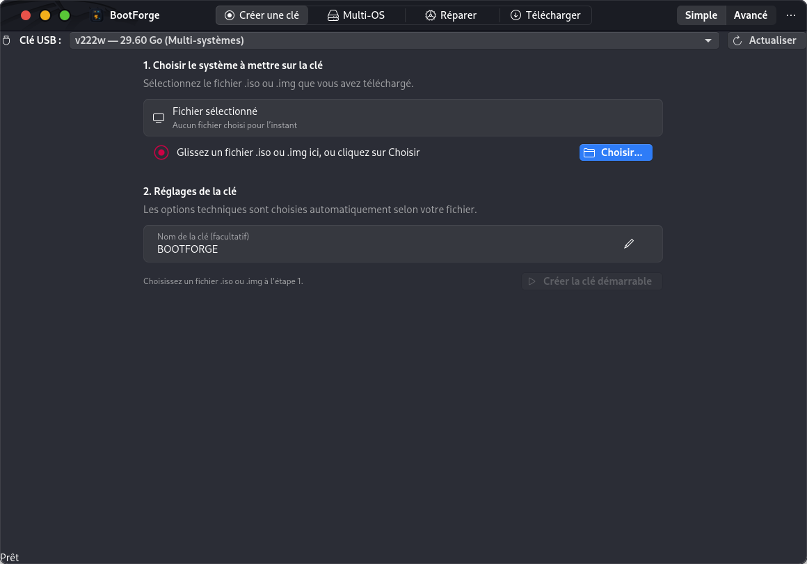
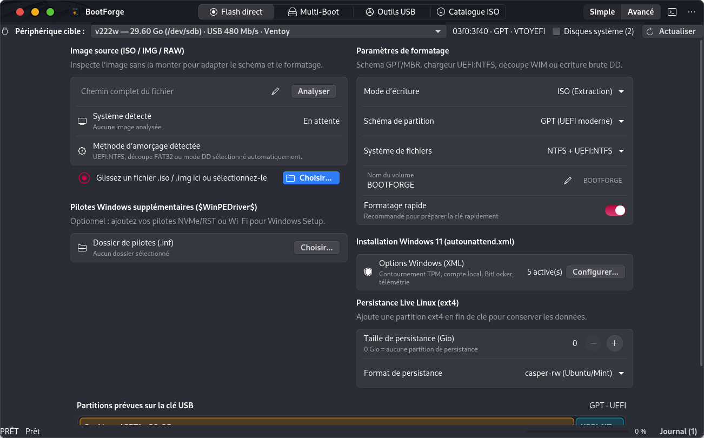
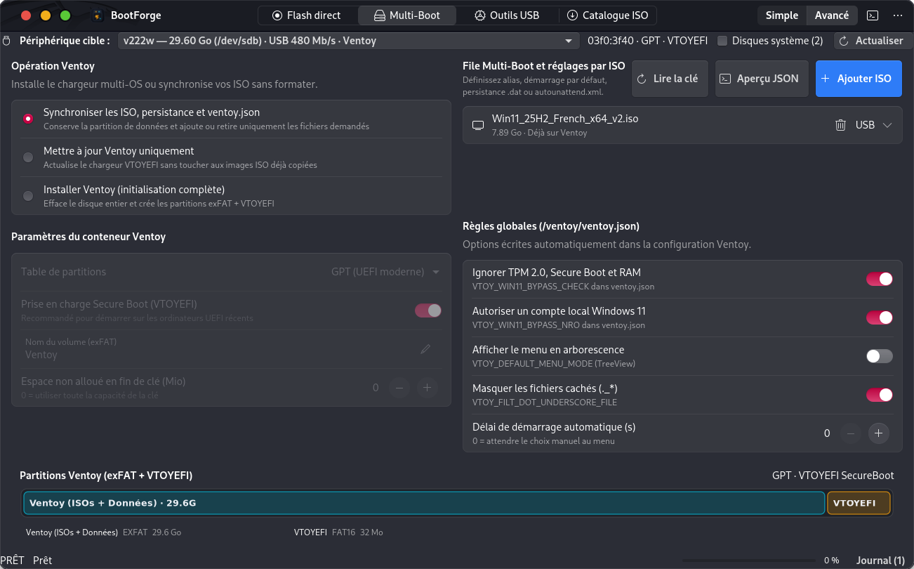
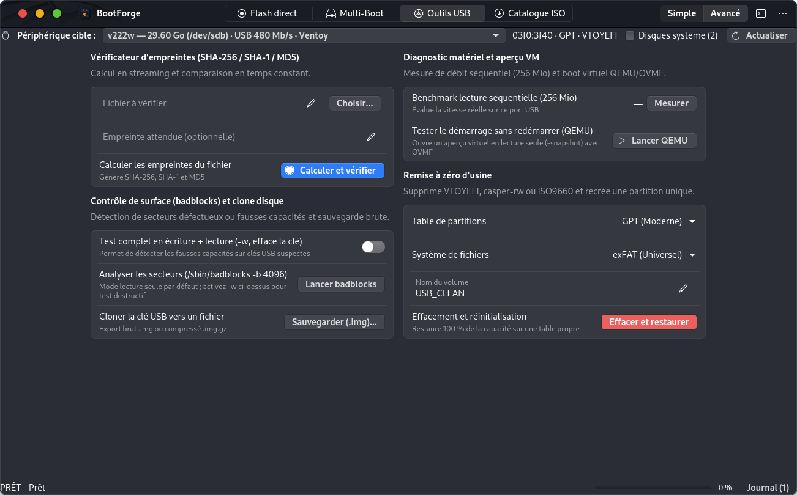

# 🚀 BootForge

[ 🇬🇧 English ](README.md) | [ 🇫🇷 Français ](README.fr.md)

[](https://github.com/NiceMank/BootForge/actions/workflows/build.yml)
[](https://github.com/NiceMank/BootForge/releases)
[](https://www.gnu.org/licenses/gpl-3.0)
[](https://github.com/NiceMank/BootForge/releases)
[](https://github.com/NiceMank/BootForge/releases)

Studio complet de création et gestion de clés USB bootables et multi-systèmes pour **Linux** et **Windows 10/11**.

BootForge réunit la puissance de **Rufus** (flash direct UEFI:NTFS, contournement Windows 11, partitionnement GPT/MBR) et la souplesse de **Ventoy** (démarrage multi-OS dynamique sur une seule clé USB), le tout avec une véritable interface graphique native adaptée à tous les profils d'utilisateurs.

---

## 📸 Aperçu de l'interface

| Mode Simple (Débutant & Rapide) | Mode Avancé (Création directe & Rufus) |
| :---: | :---: |
|  |  |

| Multi-Boot Ventoy | Boîte à outils USB & Diagnostic |
| :---: | :---: |
|  |  |

---

## 🎯 Deux modes d'utilisation au choix

Un bouton de bascule instantané dans l'en-tête permet d'adapter l'interface à votre profil :

- **Mode Simple (par défaut)** : Conçu pour les débutants et les usages rapides. Écran épuré en 3 étapes numérotées, choix de l'image ISO, sélection automatique et sécurisée des paramètres optimaux, zéro jargon technique.
- **Mode Avancé** : Conçu pour les administrateurs système et passionnés. Accès direct aux options de partitionnement (GPT/MBR), systèmes de fichiers (NTFS + UEFI:NTFS, FAT32 avec découpe de gros `install.wim`, exFAT, DD brut), générateur d'automatisation Windows 11 `autounattend.xml`, injection de pilotes `$WinPEDriver$`, règles `/ventoy/ventoy.json`, outils bas niveau (`badblocks`, QEMU/OVMF) et console d'exécution en temps réel.

---

## ✨ Fonctionnalités détaillées

### ⚡ 1. Création directe (Compatible Rufus)
- **Windows 10 / Windows 11** :
  - Support natif des images ISO officielles Microsoft.
  - Résolution automatique de la limite FAT32 de 4 Go via partition hybride **NTFS + UEFI:NTFS** (chargeur Pete Batard) ou par découpe dynamique en `.swm` (`wimlib-imagex`).
  - **Suite d'ajustements Windows 11 24H2 / 25H2** :
    - Contournement des exigences matérielles TPM 2.0, Secure Boot et 4 Go de RAM.
    - Création d'un compte local hors ligne (contournement de l'obligation de compte Microsoft).
    - Désactivation du chiffrement automatique des lecteurs par BitLocker.
    - Désactivation des questions de confidentialité et télémétrie.
    - Injection automatique d'un dossier de pilotes `$WinPEDriver$` sur la clé.
- **Distributions Linux & BSD** :
  - Écriture d'images hybrides en mode fichier ou en mode image brute (DD).
  - Prise en charge de la persistance Linux `ext4` (`casper-rw` pour Ubuntu/Mint, `persistence` pour Debian/Kali).
  - Détection automatique du schéma optimal (GPT/UEFI moderne vs MBR/BIOS hérité).

### 🔀 2. Multi-Boot dynamique (Compatible Ventoy)
- Installez ou mettez à jour le chargeur multi-systèmes Ventoy sur votre clé USB.
- **Copiez plusieurs systèmes d'exploitation sur la même clé** (ex: Windows 11 + Ubuntu 24.04 + Debian + Clonezilla).
- Ajout ou suppression de systèmes à la volée **sans formater ni effacer la clé**.
- Éditeur visuel pour `/ventoy/ventoy.json` :
  - Attribution d'alias conviviaux aux images ISO dans le menu de démarrage.
  - Sélection du système démarré par défaut et délai de compte à rebours.
  - Activation globale des contournements Windows 11 (`VTOY_WIN11_BYPASS_CHECK`, `VTOY_WIN11_BYPASS_NRO`).
  - Association de fichiers de persistance `.dat` et de réponses d'installation automatique.

### 🛠️ 3. Boîte à outils USB
- **Calculateur de sommes de contrôle** : Hachage en streaming mémoire (`SHA-256`, `SHA-1`, `MD5`) avec comparaison instantanée.
- **Test de débit séquentiel** : Mesure réelle de la vitesse de lecture continue de la clé (Mo/s).
- **Vérification de surface (`badblocks`)** : Détection des blocs défectueux avec avertissement destructeur explicite.
- **Remise à zéro d'usine** : Effacement complet des tables de partitions résiduelles et reformatage propre (FAT32 ou exFAT).
- **Sauvegarde et restauration** : Clonage d'une clé complète vers une image disque (`.img` ou compressée `.img.gz`).
- **Test en machine virtuelle** : Démarrage direct de la clé en émulation sécurisée sous QEMU (UEFI OVMF ou BIOS hérité).

### 🌐 4. Catalogue d'OS vérifiés
- Téléchargement direct en un clic d'images officielles fiables depuis les serveurs certifiés des éditeurs :
  - **Grand public** : Windows 11, Ubuntu 24.04 LTS, Linux Mint 22, Debian 12, Fedora Workstation.
  - **Experts & Sécurité** : Arch Linux, Kali Linux, Proxmox VE.
  - **Dépannage & Sauvegarde** : SystemRescue, GParted Live, Clonezilla.

### 🌍 5. Interface bilingue en direct (Français et Anglais)
- **Basculement instantané** : Changez de langue à tout moment entre le Français (`FR 🇫🇷`) et l'Anglais (`EN 🇬🇧`) depuis la barre de titre, sans redémarrer le logiciel.
- **Traductions natives soignées** : Les 4 espaces de travail, les fenêtres d'options, les indicateurs d'état et les avertissements de sécurité sont intégralement traduits.
- **Détection automatique du système** : Détecte la langue de votre système d'exploitation dès le premier lancement et mémorise votre préférence.

---

## 📥 Téléchargement et Installation

Rendez-vous sur la page des [Releases officielles](https://github.com/NiceMank/BootForge/releases).

### 🐧 Pour Linux (Debian, Ubuntu, Mint, Pop!_OS, etc.)

#### Option A : Paquet `.deb` (Recommandé)
```bash
sudo apt install ./bootforge_1.0.1_all.deb
```
L'application s'ajoute automatiquement à votre menu d'applications GNOME / KDE / XFCE.

#### Option B : Archive portable autonome
```bash
tar -xzf BootForge-1.0.1-linux.tar.gz
cd BootForge-1.0.1-linux
./bootforge
```

### 🪟 Pour Windows (Windows 10 / Windows 11 - 64 bits)

- **Programme d'installation** : Téléchargez `BootForge-1.0.1-win64-setup.exe` et suivez l'assistant.
- **Version portable** : Décompressez `BootForge-1.0.1-win64-portable.zip` et lancez `BootForge.exe`.

---

## 💻 Exécution depuis les sources

### Linux
```bash
# Dépendances système
sudo apt update && sudo apt install -y \
  python3 python3-gi python3-gi-cairo gir1.2-gtk-4.0 gir1.2-adw-1 \
  pkexec 7zip parted gdisk dosfstools ntfs-3g exfatprogs e2fsprogs util-linux udisks2

# Lancement de l'application
git clone https://github.com/NiceMank/BootForge.git
cd BootForge
./bootforge
```

### Windows
```powershell
git clone https://github.com/NiceMank/BootForge.git
cd BootForge
python -m pip install -r requirements-win.txt
python bootforge
```

---

## 🧪 Tests et compilation

### Exécuter la suite de tests
```bash
python3 -m unittest discover -s engine/tests -v
```

### Construire les paquets Linux
```bash
bash packaging/build_deb.sh
```

### Construire les paquets Windows
```powershell
python packaging/build_windows.py
makensis -DVERSION=1.0.1 packaging/win_installer.nsi
```

---

## 🤝 Contribution & Signalement de bugs

Les contributions sont les bienvenues !
- Pour signaler un bug ou proposer une fonctionnalité, ouvrez un [Ticket GitHub](https://github.com/NiceMank/BootForge/issues).
- Consultez le [Code de Conduite](CODE_OF_CONDUCT.md).

---

## 📄 Licence et crédits

Projet open-source distribué sous licence **GNU General Public License v3.0** (`LICENSE`).
- Chargeur UEFI:NTFS issu du projet [Rufus](https://github.com/pbatard/rufus) (Pete Batard, GPLv3).
- Architecture et concepts multi-boot basés sur [Ventoy](https://github.com/ventoy/Ventoy) (longpanda, GPLv3).
- Icônes et intégration visuelle inspirées du design GNOME Human Interface Guidelines et des standards modernes de fluidité bureau.
