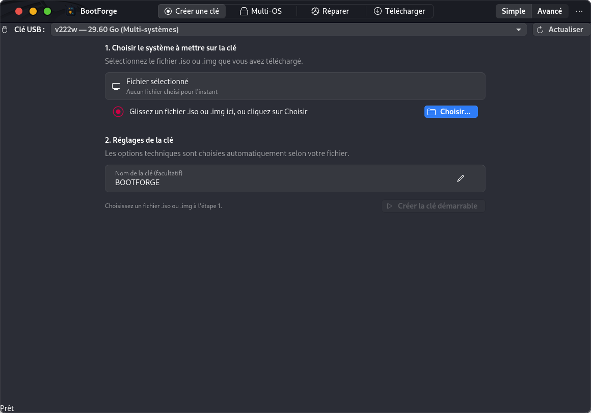
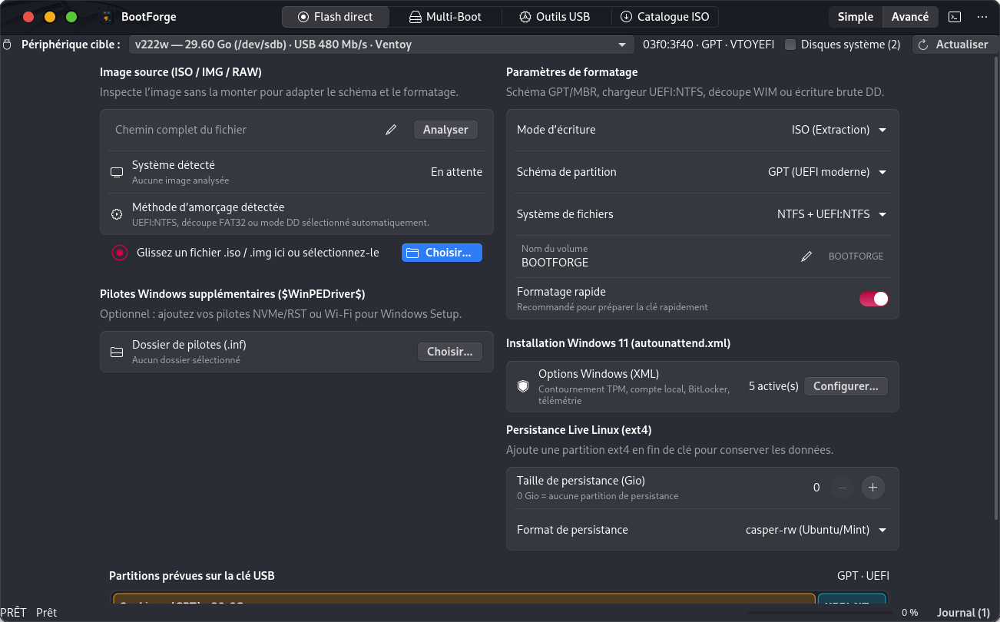
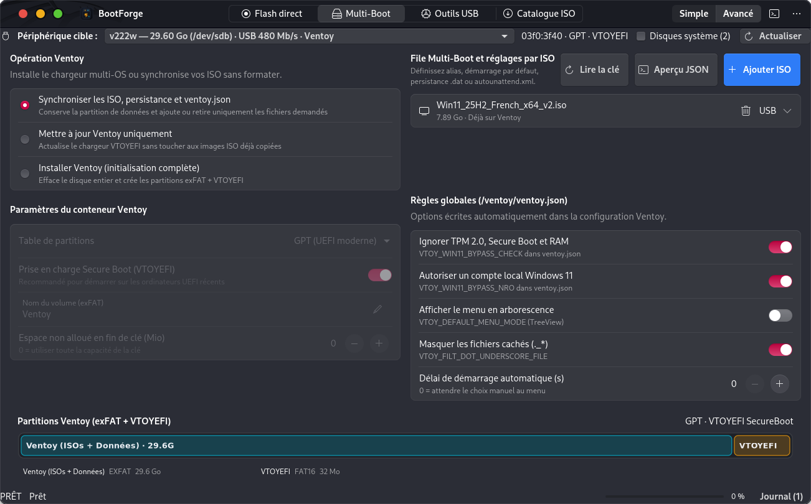
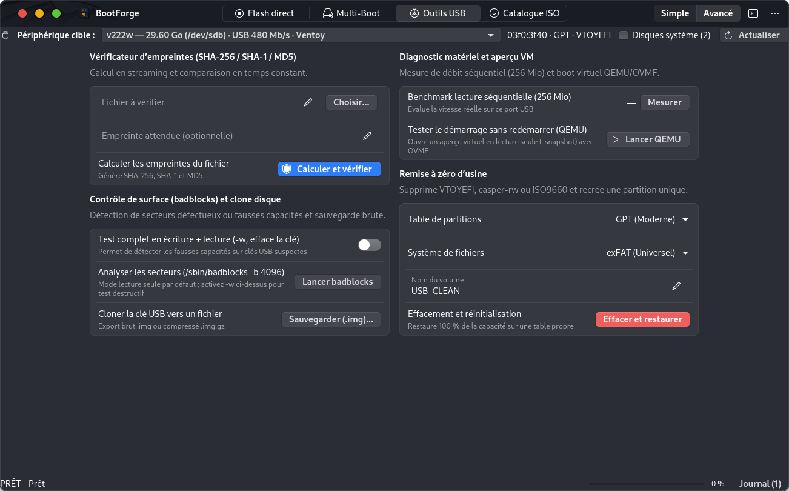

# 🚀 BootForge

[ 🇬🇧 English ](README.md) | [ 🇫🇷 Français ](README.fr.md)

[](https://github.com/NiceMank/BootForge/actions/workflows/build.yml)
[](https://github.com/NiceMank/BootForge/releases)
[](https://www.gnu.org/licenses/gpl-3.0)
[](https://github.com/NiceMank/BootForge/releases)
[](https://github.com/NiceMank/BootForge/releases)

**BootForge** is an advanced, all-in-one bootable USB creator and multi-boot management studio for **Linux** and **Windows 10/11**.

It bridges the best of both worlds:
- The raw flashing power, partition schemes, and Windows 11 hardware bypass capabilities of **Rufus** (including UEFI:NTFS support and dynamic `.swm` splitting).
- The dynamic multi-OS flexibility of **Ventoy** (drop multiple ISOs onto a single USB stick without reformatting).

Built with genuine native desktop technologies (**GTK 4 / Libadwaita** on Linux and **PyQt6** on Windows), BootForge provides a smooth, accessible user experience tailored to beginners and system administrators alike.

---

## 📸 Screenshots

| Simple Mode (Beginner-friendly 3 steps) | Advanced Mode (Direct Flash & Rufus-grade tuning) |
| :---: | :---: |
|  |  |

| Dynamic Ventoy Multi-Boot Manager | USB Diagnostic & Repair Toolbox |
| :---: | :---: |
|  |  |

---

## 🎯 Two Tailored Operating Modes

A single toggle switch in the header bar adapts the interface to your workflow:

- **Simple Mode (Default)**: Streamlined 3-step workflow designed for quick everyday use. Select your ISO, pick your drive, and flash. BootForge automatically picks the optimal partition scheme and filesystem with zero technical jargon.
- **Advanced Mode**: Full control for power users, technicians, and system administrators. Direct access to GPT/MBR partition tables, file system engines (NTFS + UEFI:NTFS, FAT32 with `.swm` splitting, exFAT, raw DD), Windows 11 `autounattend.xml` automation generator, `$WinPEDriver$` driver injection, `/ventoy/ventoy.json` visual configuration, low-level disk tools (`badblocks`, QEMU/OVMF emulation), and a real-time live execution console.

---

## ✨ Features

### ⚡ 1. Direct Flash Engine (Rufus Compatible)
- **Windows 10 & Windows 11 Support**:
  - Full support for official Microsoft ISO images.
  - Automatically handles the 4 GB FAT32 file size limit using Pete Batard's **NTFS + UEFI:NTFS** hybrid loader or dynamic `.swm` split with `wimlib-imagex`.
  - **Windows 11 (24H2 / 25H2) Bypass Suite**:
    - Bypass TPM 2.0, Secure Boot, and 4 GB RAM requirements.
    - Create a local offline account (bypasses mandatory Microsoft Account login).
    - Disable automatic BitLocker drive encryption.
    - Disable telemetry and privacy diagnostic questionnaires.
    - Automatically inject `$WinPEDriver$` driver folders directly into the installation media.
- **Linux & BSD Distributions**:
  - Supports hybrid ISO burning via standard filesystem extraction or raw disk image (`dd`) mode.
  - Optional `ext4` persistence support (`casper-rw` for Ubuntu/Mint, `persistence` for Debian/Kali).
  - Smart partition scheme selection: GPT (modern UEFI) or MBR (legacy BIOS/CSM).

### 🔀 2. Dynamic Multi-Boot (Ventoy Compatible)
- Install, update, or reconfigure Ventoy directly from the app.
- **Multi-OS on a Single Drive**: Copy multiple ISOs (e.g. Windows 11 + Ubuntu 24.04 + Proxmox + Clonezilla) to the data partition.
- Add or delete operating systems on the fly **without formatting or wiping the drive**.
- Visual Configuration Editor for `/ventoy/ventoy.json`:
  - Set custom menu aliases for ISO files.
  - Configure default boot target and timeout countdown.
  - Toggle global Windows 11 bypasses (`VTOY_WIN11_BYPASS_CHECK`, `VTOY_WIN11_BYPASS_NRO`).
  - Attach `.dat` persistence files and auto-unattend response files.

### 🛠️ 3. USB Toolbox & Diagnostics
- **Checksum Calculator**: High-speed memory-stream hashing (`SHA-256`, `SHA-1`, `MD5`) with instant target hash verification.
- **Sequential Read Benchmark**: Measures real continuous read throughput in MB/s.
- **Surface Verification (`badblocks`)**: Scan for bad sectors with explicit destructive confirmation dialogs.
- **Factory Reset**: Cleans leftover partition tables, wipes partition headers, and reformats cleanly to FAT32 or exFAT.
- **Drive Backup & Restore**: Backup entire physical USB drives to raw disk images (`.img` or compressed `.img.gz`) and restore them.
- **Virtual Machine Boot Test**: Directly test-boot your USB drive in an isolated QEMU environment (UEFI OVMF or Legacy BIOS).

### 🌐 4. Verified OS Catalog
- One-click downloads of official ISO images directly from upstream mirrors:
  - **Desktop**: Windows 11, Ubuntu 24.04 LTS, Linux Mint 22, Debian 12, Fedora Workstation.
  - **Security & Tech**: Arch Linux, Kali Linux, Proxmox VE.
  - **Rescue & Maintenance**: SystemRescue, GParted Live, Clonezilla.

---

## 📥 Download & Installation

Grab pre-built packages from the [GitHub Releases page](https://github.com/NiceMank/BootForge/releases).

### 🐧 Linux (Ubuntu, Debian, Mint, Pop!_OS, Fedora, Arch...)

#### Option A: Native Debian/Ubuntu Package (`.deb`)
```bash
sudo apt install ./bootforge_1.0.0_all.deb
```
BootForge will appear in your desktop application launcher (GNOME, KDE, XFCE).

#### Option B: Standalone Portable Archive
```bash
tar -xzf BootForge-1.0.0-linux.tar.gz
cd BootForge-1.0.0-linux
./bootforge
```

### 🪟 Windows (Windows 10 / Windows 11 - 64-bit)

- **Setup Installer**: Download `BootForge-1.0.0-win64-setup.exe` and follow the wizard.
- **Portable Zip**: Extract `BootForge-1.0.0-win64-portable.zip` and run `BootForge.exe`.

---

## 💻 Running from Source

### Linux
```bash
# System dependencies
sudo apt update && sudo apt install -y \
  python3 python3-gi python3-gi-cairo gir1.2-gtk-4.0 gir1.2-adw-1 \
  pkexec 7zip parted gdisk dosfstools ntfs-3g exfatprogs e2fsprogs util-linux udisks2

# Clone and run
git clone https://github.com/NiceMank/BootForge.git
cd BootForge
./bootforge
```

### Windows
```powershell
git clone https://github.com/NiceMank/BootForge.git
cd BootForge
python -m pip install -r requirements-win.txt
python bootforge
```

---

## 🧪 Tests & Building

### Running Unit Tests
```bash
python3 -m unittest discover -s engine/tests -v
```

### Building Linux Packages
```bash
bash packaging/build_deb.sh
```

### Building Windows Binaries
```powershell
python packaging/build_windows.py
makensis -DVERSION=1.0.0 packaging/win_installer.nsi
```

---

## 🤝 Contributing

Contributions, bug reports, and suggestions are welcome!
- Open an [Issue](https://github.com/NiceMank/BootForge/issues) for bug reports or feature requests.
- Please review our [Code of Conduct](CODE_OF_CONDUCT.md).

---

## 📄 License & Credits

Distributed under the **GNU General Public License v3.0** (`LICENSE`).
- UEFI:NTFS loader credited to the [Rufus](https://github.com/pbatard/rufus) project (Pete Batard, GPLv3).
- Multi-boot concepts and runtime based on [Ventoy](https://github.com/ventoy/Ventoy) (longpanda, GPLv3).
- Visual integration strictly adheres to the GNOME Human Interface Guidelines and modern fluid desktop UX standards.
